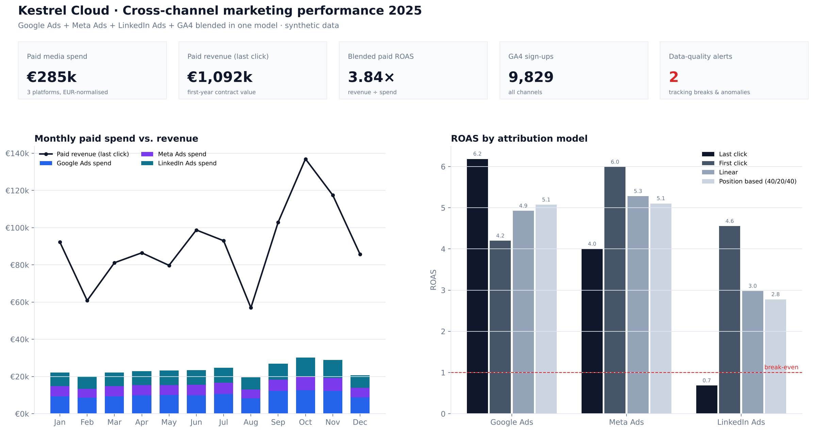
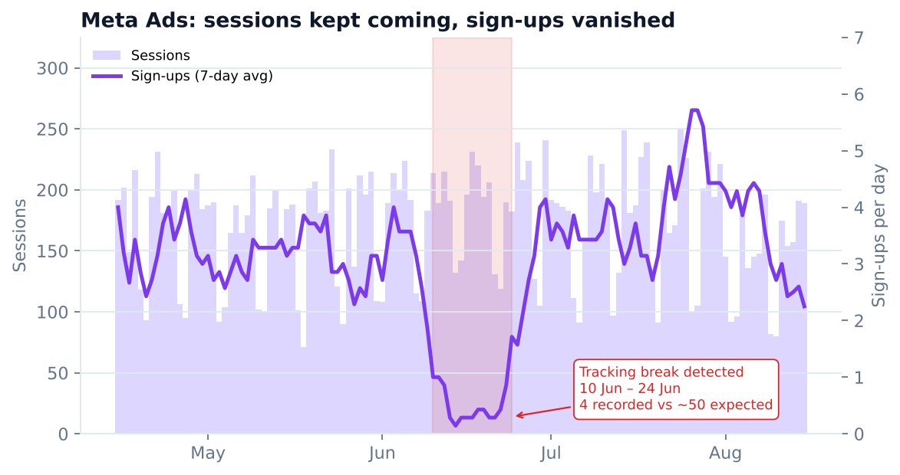
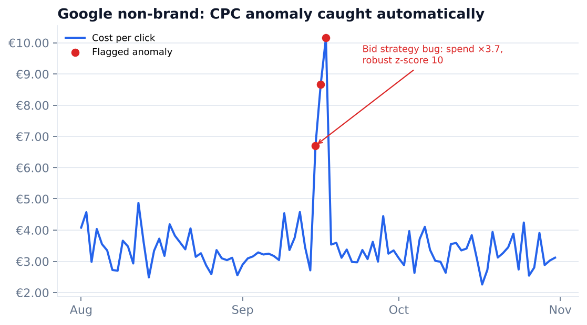
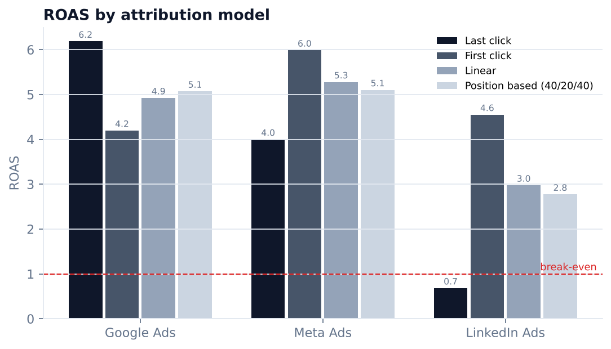
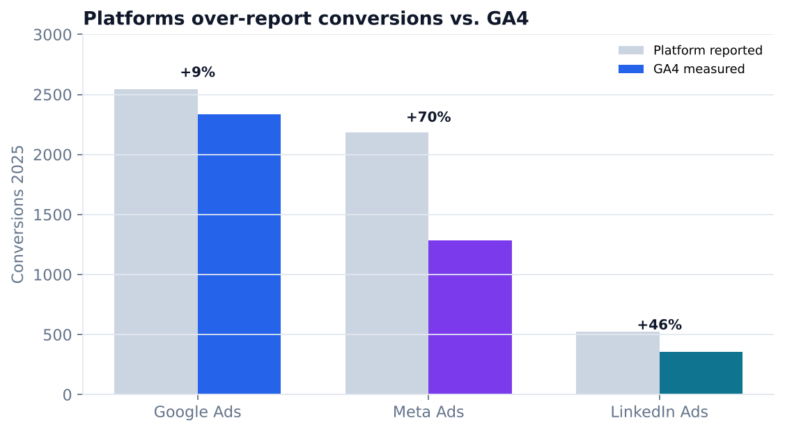

# Cross-Channel Marketing Analytics Pipeline

**Google Ads + Meta Ads + LinkedIn Ads + GA4 → one trusted data model → automated quality checks, anomaly detection and attribution.**

[](https://github.com/jemsgolakiya/marketing-analytics-pipeline/actions/workflows/ci.yml)




> **The data is synthetic.** "Kestrel Cloud" is a fictional B2B SaaS company, and every number is generated by
> [`generate.py`](marketing_pipeline/generate.py). The *problems* in the data are real, though. They are the ones I fixed
> day to day as a marketing data analyst: inconsistent exports, broken UTMs, duplicate rows, platforms over-reporting
> conversions, and tracking events that silently stop firing.

---

## The problem

Every ad platform tells its own story. Google exports cost in micros, Meta bills in USD, LinkedIn uses US date formats and overlapping exports, and each one claims more conversions than GA4 measured. Teams end up arguing about *whose numbers are right* instead of deciding where the next euro goes.

This project builds the layer that ends those arguments:

1. **One model, shared definitions.** Spend, conversion and attribution window mean the same thing on every channel.
2. **Quality gates before reporting.** Broken data is caught before it reaches a stakeholder.
3. **Attribution that shows the trade-offs**, not a single "true" number.

## What the pipeline found

| Finding | Evidence | What a team would do |
|---|---|---|
| **A GA4 tracking break hid two weeks of Meta conversions.** | Sessions stayed normal from 10 to 24 June, but only 4 sign-ups were recorded against ~50 expected. | Fix the event and annotate the period, rather than cutting a channel that was actually working. |
| **A bid-strategy bug tripled Google non-brand spend.** | Cost per click hit €10 for 3 days (robust z-score up to 17) with no extra sign-ups. | Alert within a day instead of finding it at month-end. |
| **Last-click attribution makes LinkedIn look like a loss.** | ROAS is **0.68×** on last click but **4.55×** on first click and **3.0×** linear. LinkedIn opens journeys that other channels close. | Judge LinkedIn on assisted revenue before cutting its budget. |
| **Platforms over-report conversions.** | Compared with GA4: Meta +70%, LinkedIn +46%, Google +9%. | Optimise on GA4-measured conversions, not platform dashboards. |
| **28 duplicate rows in the LinkedIn export.** | Overlapping export windows in March. | De-duplicated in staging, and a reconciliation test keeps it that way. |

<p>
  
  
</p>
<p>
  
  
</p>

The full generated report, with every check, incident and KPI, is in [`outputs/report.md`](outputs/report.md).

## How it works

```mermaid
flowchart LR
    subgraph raw["Raw exports (CSV)"]
        G[Google Ads<br/>cost in micros]
        M[Meta Ads<br/>spend in USD]
        L[LinkedIn Ads<br/>US dates, duplicates]
        A[GA4 sessions<br/>messy UTMs]
        P[GA4 conversion paths]
        F[FX rates]
    end
    subgraph stg["staging/"]
        S1[typed, de-duplicated,<br/>EUR-normalised,<br/>channel mapping]
    end
    subgraph int["intermediate/"]
        I1[int_ad_spend]
        I2[int_attribution_weights]
    end
    subgraph mart["marts/"]
        M1[channel daily & summary]
        M2[attribution]
        M3[platform vs GA4]
    end
    raw --> stg --> int --> mart
    mart --> Q[quality checks<br/>+ anomaly detection]
    Q --> R[report.md + charts]
```



| Layer | What happens | Files |
|---|---|---|
| **Raw** | Every CSV lands as an all-text table. Nothing is trusted yet. | [`warehouse.py`](marketing_pipeline/warehouse.py) |
| **Staging** | Types, units (micros → EUR, USD → EUR with daily FX), date formats, de-duplication, and a UTM → channel mapping that handles `fb` / `facebook` / `Facebook` / `meta`. | [`sql/staging`](sql/staging) |
| **Intermediate** | A single spend model across platforms, plus touchpoint weights for four attribution models. | [`sql/intermediate`](sql/intermediate) |
| **Marts** | Daily and yearly channel KPIs (CTR, CPC, CVR, CPA, ROAS), attribution comparison, and platform-vs-GA4 reconciliation. | [`sql/marts`](sql/marts) |
| **Quality** | Row counts, duplicates, grain, spend reconciliation, UTM coverage, tracking-break detection. | [`quality.py`](marketing_pipeline/quality.py) |
| **Anomalies** | Rolling median + MAD robust z-scores on spend and CPC, so one bad day can't mask the next. | [`anomaly.py`](marketing_pipeline/anomaly.py) |

### Tracking-break detection

A real performance drop moves sessions and conversions together. A **tracking** problem shows up as normal traffic with conversions near zero. The detector compares recorded sign-ups with what the channel's normal conversion rate predicts, on a centred 7-day window, and only alerts when enough conversions were expected to make the gap meaningful. That avoids false alarms on low-volume channels. It then refines the incident edges day by day. On this data it finds the planted incident to the exact day and raises no false positives.

### Attribution models

All four models are written in plain SQL with window functions ([`int_attribution_weights.sql`](sql/intermediate/int_attribution_weights.sql)), and tests check that every conversion's credit sums to exactly 1:

- **Last click** and **first click**
- **Linear:** equal credit to every touch
- **Position based (40/20/40):** 40% each to the first and last touch, 20% shared across the middle

## Run it

```bash
git clone https://github.com/jemsgolakiya/marketing-analytics-pipeline.git
cd marketing-analytics-pipeline
pip install -r requirements.txt

python -m marketing_pipeline.generate   # optional: regenerate raw data (seeded, deterministic)
python -m marketing_pipeline.run        # build models, run checks, write report + charts
pytest -q                               # 9 tests: attribution, dedupe, reconciliation, detectors
```

Explore the warehouse afterwards with any DuckDB client:

```sql
-- outputs/warehouse.duckdb
SELECT * FROM mart_channel_summary;
SELECT * FROM mart_attribution WHERE channel = 'LinkedIn Ads';
```

CI runs the whole pipeline and the test suite on every push.

## Project structure

```
├── data/raw/                 # synthetic exports, one CSV per source
├── sql/
│   ├── staging/              # stg_*  typing, units, dedupe, channel mapping
│   ├── intermediate/         # int_*  unified spend, attribution weights
│   └── marts/                # mart_* KPI tables for BI tools
├── marketing_pipeline/
│   ├── generate.py           # synthetic data with realistic problems
│   ├── warehouse.py          # load raw → build SQL layers in order
│   ├── quality.py            # data-quality checks + tracking-break detector
│   ├── anomaly.py            # robust z-score anomaly detection
│   ├── charts.py             # report charts
│   └── run.py                # end-to-end entry point
├── outputs/                  # report.md, KPI CSVs
├── tests/
└── .github/workflows/ci.yml
```

## Why DuckDB?

The SQL is ANSI-style and maps almost one to one onto BigQuery, Snowflake or Postgres. DuckDB keeps the project runnable with a single `pip install` and no cloud account. The mart tables can feed Looker Studio or Power BI directly as CSV, or through a warehouse in production.

---

Built by **Jemish Golakiya**, Data Analyst for Marketing Analytics & BI in Frankfurt am Main.
[LinkedIn](https://www.linkedin.com/in/golakiya-jemish) · [GitHub](https://github.com/jemsgolakiya)
